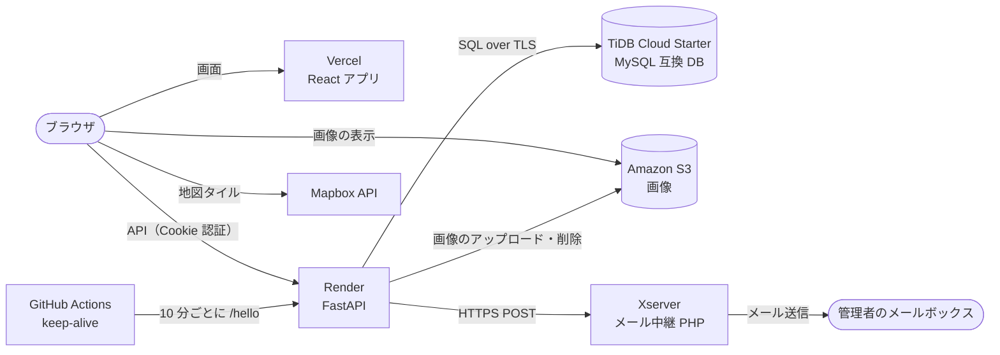

# 全体構成

## 構成図

| 構成要素 | 役割 | 補足 |
|---|---|---|
| Vercel | フロントエンドの配信（`react-app/`） | `main` への push で自動デプロイ |
| Render | バックエンド API（`backend/`） | 無料プラン、リージョンは Singapore。`main` への push で自動デプロイ |
| TiDB Cloud Starter | データベース | 無料枠で運用。接続は TLS 必須（[database.md](database.md)） |
| Amazon S3 | 画像の保存と配信 | バケットは ap-northeast-1。オブジェクトは公開読み取り |
| Xserver | お問い合わせ通知メールの送信 | [mail-relay.md](mail-relay.md) |
| GitHub Actions | Render のスリープ防止 | `main` ブランチの `.github/workflows/keep_alive.yml` |
| Mapbox | 地図の表示 | フロントエンドから直接利用 |

## バックエンドの層構造

`backend/` は次の層に分かれています。

| ディレクトリ | 役割 |
|---|---|
| `routers/` | エンドポイントの定義、レート制限、管理者権限のチェック |
| `cruds/` | DB の読み書き、S3 への画像保存・削除 |
| `models/` | SQLAlchemy のテーブル定義 |
| `schemas/` | Pydantic のリクエスト／レスポンス定義 |
| `logic/` | 認証（`auth.py`）、S3（`upload.py`）、メール（`mail.py`）、入力整形（`input.py`） |
| `database/` | DB 接続（`db.py`）、DB コピースクリプト（`copy_db.py`） |
| `properties/` | 環境変数の読み込みと定数（`properties.py`） |

## 認証

- ログインすると、JWT のアクセストークン（1 時間）とリフレッシュトークン（30 日）を HttpOnly・Secure の Cookie に保存します。
- フロントエンドは API が 401 を返すと `/users/refresh` でアクセストークンを取り直し、元のリクエストを 1 回だけ再試行します（`react-app/src/api/axiosInstance.ts`）。
- パスワードは bcrypt でハッシュ化して保存します。
- ユーザー登録の API はありません。ユーザーは DB に直接登録します。
- 権限は `user_attributes` で管理し、管理者向け API は `user_attribute_name` が `admin` のユーザーだけが使えます。
- フロントエンドと API はオリジンが異なるため、CORS の許可オリジンは `backend/properties/properties.py` の `origins` で管理しています。

## 画像

- 画像は API が受け取り、S3 に `公開読み取り` でアップロードします。DB には S3 の URL を保存します。
- S3 のキーは用途ごとに分かれています。

| プレフィックス | 内容 |
|---|---|
| `icons/` | アニメのアイコン |
| `anime/` | アニメ画像（作中のシーン） |
| `reals/` | 現地写真 |

- ファイル名は `<UUID>_<元のファイル名>` です。
- アニメ・聖地・コメント・写真を削除すると、対応する S3 のオブジェクトも削除します。

## お問い合わせメール

Render の無料プランは外向きの SMTP ポートを塞いでいるため、API から直接メールを送れません。代わりに API が Xserver 上の PHP スクリプトへ HTTPS で POST し、PHP がメールを送ります。

- 送信先は PHP 側の設定で固定で、管理者への通知のみを送ります（問い合わせた人への自動返信はありません）。
- 通知メールの `Reply-To` に問い合わせた人のアドレスが入るので、そのまま返信できます。
- メール送信に失敗しても、お問い合わせ自体は DB に保存され、管理画面から確認できます。

## 公開範囲とレート制限

- 本番（`ENV=production`）では Swagger UI（`/docs`、`/redoc`）を無効にしています。
- 認証確認系を除くエンドポイントに、slowapi による IP 単位のレート制限があります（[api.md](api.md)）。

## 運用コスト

Vercel、Render、TiDB Cloud はいずれも無料枠で運用しています。費用がかかるのは S3 と、契約済みの Xserver です。

2026-11-17 に、DB を AWS RDS（MariaDB）から TiDB Cloud Starter に移行しました。
